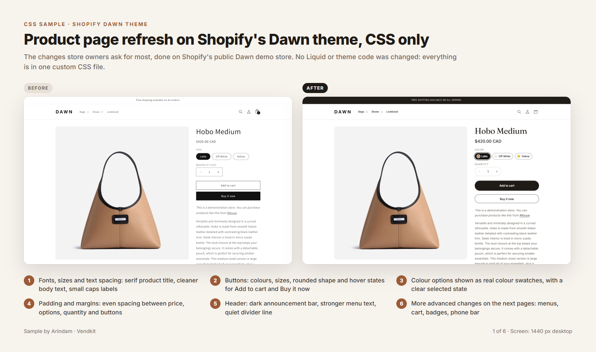
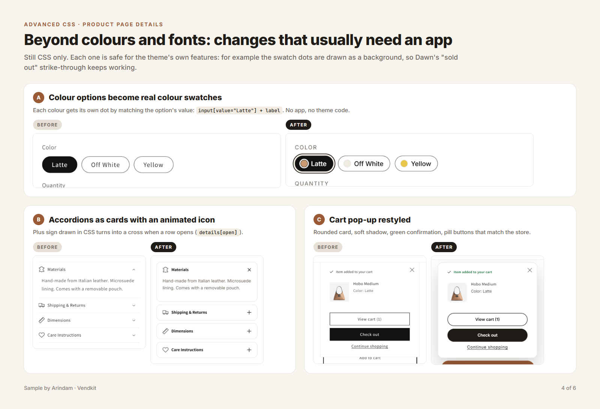
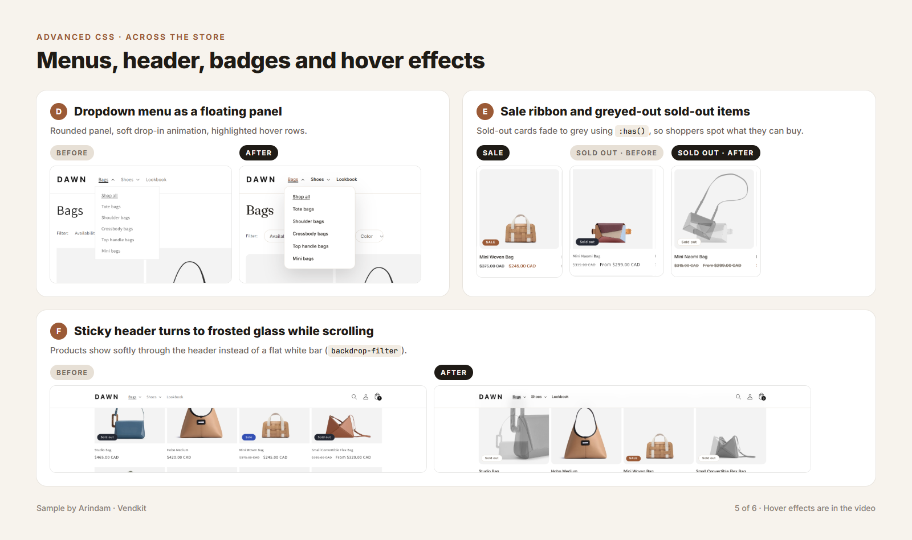
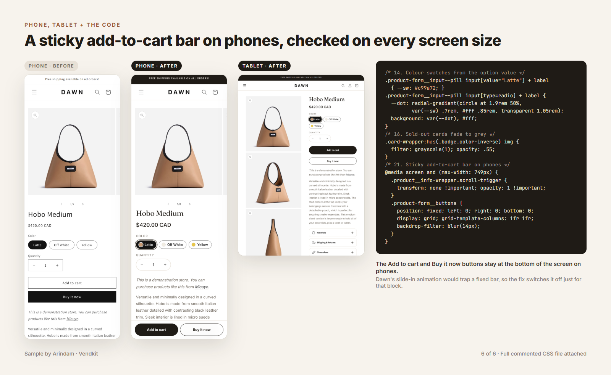

# Shopify Dawn theme restyle with custom CSS (sample)

A full restyle of Shopify's free **Dawn** theme made with **one CSS file**. No Liquid templates, theme settings or apps were changed. It was built and tested on Shopify's public Dawn demo store.



## What it changes

| # | Area | Change |
|---|---|---|
| 1-8 | Basics | Fonts, price, buttons, variant pills, spacing, header, footer, mobile layout |
| 9 | Buttons | Rounded-button clean-up |
| 10-12 | Store | Collection page, home banner, footer |
| 13 | Tablet | Product title size |
| 14 | Product | Colour options shown as real colour swatches (matched by option value) |
| 15 | Product | Details accordions as cards with an animated plus icon |
| 16-17 | Collection | Sale ribbon, sold-out items greyed out (`:has()`), "View" pill on hover |
| 18 | Menu | Dropdown menu as a floating panel |
| 19 | Header | Frosted-glass sticky header while scrolling (`backdrop-filter`) |
| 20 | Cart | Cleaner cart pop-up |
| 21 | Phone | Sticky add-to-cart bar at the bottom of the screen |
| 22 | Access | Visible keyboard focus and reduced motion support |

Every section is commented in [`custom-refresh.css`](custom-refresh.css).







## How to add it to a Dawn store

1. In Shopify admin go to **Online Store > Themes**, and **Duplicate** your live theme. Work on the copy.
2. On the copy, choose **Edit code**. Under **Assets**, add a new file named `custom-refresh.css` and paste in the contents of this file.
3. Open `layout/theme.liquid` and add this line just before `</head>`:

   ```liquid
   {{ 'custom-refresh.css' | asset_url | stylesheet_tag }}
   ```

4. Preview the copy on desktop, tablet and phone, then publish it when you are happy.

The swatch colours in section 14 match the demo store's option names (Latte, Off White, Yellow, Black). Change them to your own option names and colours.

## Notes

- Built for Dawn. Other themes use different class names, so the selectors would need adjusting.
- Dawn's own features keep working: for example the swatch dots are drawn as a background, so Dawn's "sold out" strike-through still shows.

## Need this for your store?

I customize Shopify themes, build Shopify apps and fix store bugs.

- Website: [vendkitapps.com](https://vendkitapps.com)
- Hire me on Upwork: [Arindam S.](https://www.upwork.com/freelancers/~019eab4b172aa9dad4)

## License

MIT. Use it in your own store.
